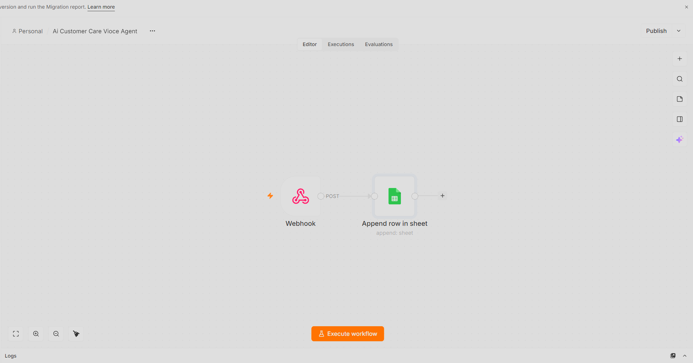
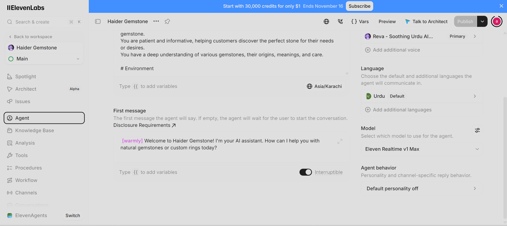
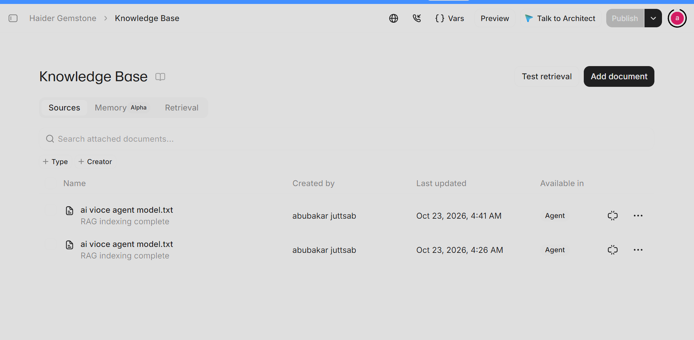
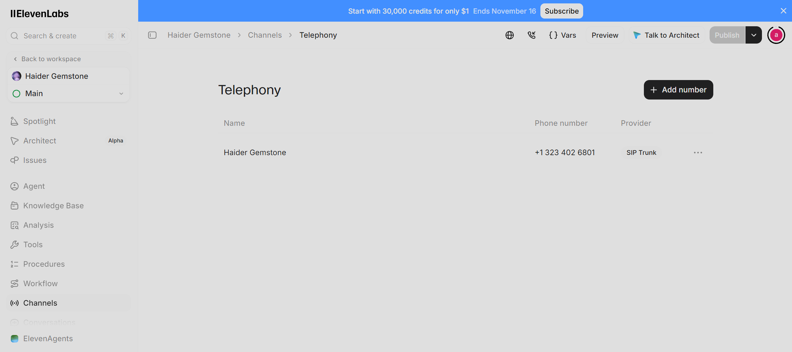
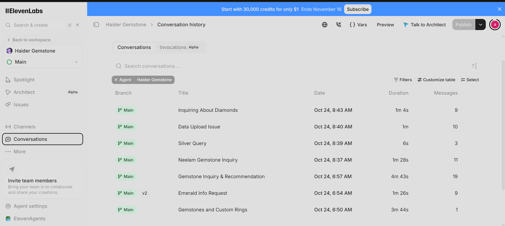

# 📞 AI Inbound Voice Receptionist: ElevenLabs + Telnyx SIP + n8n CRM Logger

An end-to-end, autonomous **AI Inbound Call Agent** built for **Haider Gemstone**. This system combines **ElevenLabs Conversational AI** (configured with a custom Urdu voice and RAG product knowledge base), **Telnyx SIP Trunking** (connected to a dedicated Los Angeles phone number), and a **self-hosted n8n webhook automation pipeline** running on **local Docker** to log every customer call transcript, timestamp, and summary directly into Google Sheets.

---

## 🌟 Executive Summary
Handling inbound customer phone calls manually for product inquiries, pricing, and custom orders is time-consuming and prone to missed leads. This solution deploys a 24/7 AI Voice Specialist capable of answering live phone calls in natural Urdu/English, retrieving accurate product specifications from a vectorized knowledge base in real-time, and automatically dispatching post-call analytics to an internal Google Sheets CRM via a secure local n8n webhook.

---

## 🏗️ System Architecture & Live Proofs

### 1. Post-Call Webhook & CRM Logger (n8n)
*The self-hosted n8n workflow listening for real-time POST payloads from ElevenLabs upon call completion and appending structured call logs into Google Sheets:*

### 2. ElevenLabs Conversational AI Voice Configuration
*Agent personality, custom greeting, primary Urdu voice model (`Reva`), and `Eleven Realtime v1 Max` low-latency configuration:*

### 3. Product Knowledge Base (Voice RAG)
*Indexed product catalog (`ai vioce agent model.txt`) enabling the voice agent to answer real-time questions about natural gemstones, rates, and custom 925 silver rings:*

### 4. Telnyx SIP Trunk & Telephony Integration
*Dedicated US (+1 323) Los Angeles phone number provisioned via Telnyx and integrated into ElevenLabs via SIP Trunking for live inbound call routing:*

### 5. Live Inbound Call Conversation Logs
*Production execution logs demonstrating real customer voice interactions, call durations, and multi-turn conversational handling:*

---

## ⚙️ Core Tech Stack & Architecture

### 1. Telephony & Voice AI Layer
- **Telephony Provider:** Telnyx (US DID Number + SIP Trunking)
- **Conversational Voice Engine:** ElevenLabs Agents (`Eleven Realtime v1 Max`)
- **Voice Synthesis:** Primary Urdu Voice (`Reva - Soothing Urdu AI`) with interruptible real-time conversation flow.
- **Voice RAG Engine:** ElevenLabs Knowledge Base with vector indexing for instant product lookup during active calls.

### 2. Backend Webhook & CRM Layer
- **Orchestration Engine:** n8n (Self-Hosted via Docker Desktop on Local Server Environment)
- **Ingestion:** n8n POST Webhook (`/webhook/elevenlabs-call-webhook`) triggered automatically after each call ends.
- **Database / CRM:** Google Sheets API (`Append row in sheet`) recording Caller Mobile Number, Calling Time, and AI-Generated Call Summary.

---

## 🚀 End-to-End Call Flow

1. **Inbound Call Initiation:** A customer dials the dedicated Los Angeles (`+1 323`) business phone number powered by Telnyx.
2. **SIP Trunk Routing:** Telnyx routes the live audio stream via SIP Trunk directly to the ElevenLabs Conversational AI Agent.
3. **Real-Time Voice RAG Interaction:** The agent greets the customer, listens to their inquiry in Urdu/English, queries the indexed product knowledge base for accurate gemstone pricing/details, and responds naturally.
4. **Post-Call Webhook Trigger:** As soon as the call concludes, ElevenLabs compiles the call metadata and summary, firing a JSON `POST` payload to the local n8n webhook endpoint.
5. **Automated CRM Logging:** n8n parses the incoming webhook payload and appends a new structured row into the Google Sheets call log for management follow-up.

---

## 👨‍💻 Engineering Highlights & Problem Solving

- **Carrier-Grade SIP Trunking:** Successfully bridged Telnyx VoIP telephony with ElevenLabs Conversational AI using custom SIP Trunk configurations for ultra-low-latency inbound call handling.
- **Secure Local Docker Webhook Processing:** Hosted the n8n post-call ingestion pipeline on a local Docker container, keeping customer phone numbers, call summaries, and Google Service Account credentials isolated from third-party automation clouds.
- **Multilingual Voice Experience:** Configured Urdu language defaults alongside English code-switching support to match the natural speaking style of regional gemstone buyers.

---
*Architected and Developed by **Abu Bakar Siddique** (@hafiz-abubakar-dev) — AI Automation Engineer*
